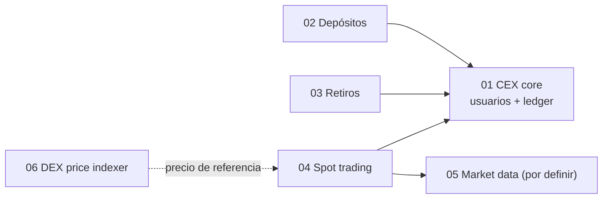

<div align="center">

# 🦀 rust-exchange-lab

**Aprende Rust + Axum construyendo el backend de un exchange cripto sobre Solana. Desde cero, módulo por módulo.**


[](LICENSE)

</div>

---

## ¿Qué es esto?

Un **laboratorio de práctica guiada**. No es un tutorial con el código resuelto: es una serie de **6 sistemas reales**, cada uno con su caso de uso, sus tablas de base de datos, sus endpoints, sus requisitos y sus criterios de aceptación. **Tú escribes todo el código.**

Juntos forman el backend de **TuyCEX**, un exchange centralizado ficticio sobre Solana:



### ¿Para quién es?

- Para quien ya sabe lo básico de Rust (ownership, structs, enums, `Result`) y quiere **dar el salto a backend de verdad**.
- Para devs backend que vienen de otros lenguajes y quieren aprender Rust con **problemas reales** en lugar de ejercicios sueltos.
- Para builders de Solana que dominan Anchor pero quieren entender **el lado off-chain**: indexadores, watchers, ledgers y APIs.

### Qué vas a aprender

| Área | Temas |
|------|-------|
| **Rust** | newtypes, traits y generics, manejo de errores (`thiserror`/`anyhow`), typestate, lifetimes, `u128` y checked math, `proptest`, `criterion` |
| **Axum + Tokio** | routers, extractors propios, `IntoResponse`, middleware `tower`, WebSockets, tasks, canales, `select!`, graceful shutdown |
| **Datos** | SQLx, migraciones, transacciones ACID, niveles de aislamiento, locking, idempotencia, ledger de doble entrada |
| **System design** | monolito modular, pipelines con backpressure, máquinas de estado, sagas, pub/sub, snapshots + deltas, oráculos |
| **Solana** | JSON-RPC, cuentas y token accounts, SPL/Token-2022, commitment, construir y firmar transacciones, leer pools AMM |
| **Matemáticas** | punto fijo vs flotante, invariantes, teoría de colas (Ley de Little), backoff exponencial, VWAP/TWAP, AMM `x·y=k` |

---

## 🗺️ Roadmap

| # | Módulo | Qué construyes | Rust que practicas | Tiempo |
|---|--------|----------------|--------------------|--------|
| 01 | [cex-core](crates/cex-core) | Usuarios, cuentas y **ledger de doble entrada** | `AppError`, extractors, transacciones SQL, concurrencia | 2 sem |
| 02 | [cex-deposits](crates/cex-deposits) | Direcciones de depósito + watcher on-chain + acreditación | Tokio: tasks, canales, `select!`, shutdown, idempotencia | 2 sem |
| 03 | [cex-withdrawals](crates/cex-withdrawals) | Retiros con límites, aprobación, firma y envío | typestate, firmar transacciones, reintentos | 1–2 sem |
| 04 | [cex-spot-trading](crates/cex-spot-trading) | Órdenes + **matching engine** + liquidación | colecciones, actor pattern, `proptest`, `criterion` | 2 sem |
| 05 | [cex-market-data](crates/cex-market-data) *(por definir)* | Ticker, velas y orderbook en vivo por REST + WS | WebSockets, `broadcast`, middleware `tower` | 1 sem |
| 06 | [dex-price-indexer](crates/dex-price-indexer) | Precios on-chain desde pools AMM + cotizador de swaps | bytes crudos, `u128`, traits, performance | 1–2 sem |

> 💡 Hazlos en orden. Cada uno se apoya en lo que aprendiste en el anterior, y del 02 al 04 dependen de `cex-core`.

### ¿Qué trae el README de cada módulo?

- **Qué construyes** y sus **4 features**
- **Base de datos**: tablas y columnas
- **API**: tabla de endpoints
- **Requisitos** funcionales (RF) y no funcionales (RNF), numerados
- **Criterios de aceptación**: conviértelos directamente en tests
- **Conceptos a estudiar**: Rust/Axum, system design, Solana, **matemáticas** y lecturas

---

## 🏗️ Arquitectura: monolito modular

Un solo backend dividido en módulos, usando un **Cargo workspace**:

```
rust-exchange-lab/
├── Cargo.toml              # workspace: members = ["apps/*", "crates/*"]
├── apps/
│   └── server/             # el ÚNICO binario: config, DB, Axum, compone los módulos
├── crates/
│   ├── shared/             # lo que usan 2+ módulos (Scope Rule)
│   ├── cex-core/
│   ├── cex-deposits/       # depende de cex-core
│   ├── cex-withdrawals/    # depende de cex-core
│   ├── cex-spot-trading/   # depende de cex-core
│   ├── cex-market-data/
│   └── dex-price-indexer/
├── index.html + web/       # web de estudio (ver abajo)
└── README.md
```

**¿Cómo se organiza?**

| Concepto | En este repo |
|----------|--------------|
| Monorepo | Cargo workspace (`Cargo.toml` raíz con `members`) |
| Punto de entrada | `apps/server` (el único binario) |
| Un dominio del negocio | Un crate en `crates/` (cada uno con su propio `src/`) |
| API pública del dominio | lo que el crate marca como `pub` en su `lib.rs` |
| Dependencias entre dominios | `[dependencies]` en su `Cargo.toml` |

La gran ventaja: **el compilador hace cumplir las fronteras**. Si `cex-deposits` no declara `cex-core` como dependencia, no puede tocarlo.

---

## 🚀 Cómo empezar

```bash
# 1. Haz fork del repo y clónalo
git clone https://github.com/<tu-usuario>/rust-exchange-lab
cd rust-exchange-lab

# 2. Comprueba que el workspace compila (todos los módulos están vacíos)
cargo build

# 3. Abre la web de estudio
python3 -m http.server 4321    # → http://localhost:4321

# 4. Lee crates/cex-core/README.md y empieza a codear 🦀
```

**Requisitos:** Rust estable (edition 2024), Docker (para Postgres desde el módulo 01) y la [CLI de Solana](https://solana.com/docs/intro/installation) para crear wallets de devnet.

### Comandos útiles

```bash
cargo run -p server                                   # levantar el backend completo
cargo test -p cex-core                                # tests de un módulo
cargo clippy --all-targets -- -W clippy::pedantic     # lints estrictos
cargo fmt --check
```

---

## 🌐 Web de estudio

En la raíz hay una web local para ver todo ordenado y **llevar tu progreso**:

- Renderiza los README de cada módulo con un **checkbox en cada feature, requisito, criterio y concepto**.
- Barras de progreso de **Construcción**, **Estudio** y **Método** por módulo.
- Estado de cada módulo (sin empezar / en progreso / terminado, con fechas), **notas** por módulo, actividad reciente y una tarjeta de **"siguiente paso"**.
- Todo se guarda en el `localStorage` de tu navegador. Con **Exportar/Importar** haces backup en JSON.
- Modo claro y oscuro; funciona en móvil.

Es JavaScript puro con módulos ES (sin build) y está en `web/`.

---

## 🧭 Método por módulo

1. **Lee el README** del módulo completo.
2. **Diseña antes de codear**: escribe en 10 líneas tus tipos, tus módulos internos y el flujo.
3. **Tests primero**: convierte los criterios de aceptación en tests.
4. **Implementa** con commits pequeños (`feat:`, `test:`, `refactor:`).
5. **Pule**: `clippy::pedantic` limpio y cero `unwrap()` fuera de los tests.
6. **Escribe `APRENDIZAJES.md`**: qué aprendiste, qué error del compilador te costó y qué harías distinto.
7. **Refactor de regreso**: mejora algo de un módulo anterior con lo que sabes ahora.

### ✅ Definición de "terminado"

- [ ] Todos los criterios de aceptación cubiertos por tests
- [ ] `cargo clippy --all-targets -- -W clippy::pedantic -D warnings` sin warnings
- [ ] `cargo fmt --check` OK
- [ ] Cero `unwrap()` / `expect()` fuera de tests
- [ ] `APRENDIZAJES.md` escrito

---

## 📚 Recursos

**Rust y backend**
- *Zero To Production in Rust* (Luca Palmieri): la referencia para Axum + SQLx
- *Rust for Rustaceans* (Jon Gjengset): a partir del módulo 02
- *Designing Data-Intensive Applications* (Martin Kleppmann): el libro de system design
- [Ejemplos de Axum](https://github.com/tokio-rs/axum/tree/main/examples) y el [tutorial de Tokio](https://tokio.rs/tokio/tutorial)

**Matemáticas**
- *Mathematics for Computer Science* (MIT, gratis): lógica, inducción y probabilidad
- *Concrete Mathematics* (Graham, Knuth y Patashnik): para ir más profundo
- Khan Academy: estadística y derivadas, como repaso para los módulos 06 y 07

**Solana**
- [Documentación oficial: Core concepts](https://solana.com/docs/core)
- [JSON-RPC API](https://solana.com/docs/rpc)

---

## 🤝 Contribuir

¿Encontraste un requisito ambiguo, un error en un caso de uso o se te ocurre un módulo nuevo (KYC, portafolio, notificaciones…)? Abre un issue o un PR.

**Las soluciones no van en este repo.** Si quieres compartir la tuya, enlaza tu fork en un issue para que otros puedan comparar enfoques.

---

## 📄 Licencia

[MIT](LICENSE): úsalo, modifícalo y compártelo libremente, incluso en tus cursos o talleres, manteniendo el aviso de copyright.

---

<div align="center">

Hecho con 🦀 por [@victoraranguren](https://github.com/victoraranguren) · *TuyCEX es ficticio y este código es educativo: no lo uses en producción con fondos reales.*

</div>
